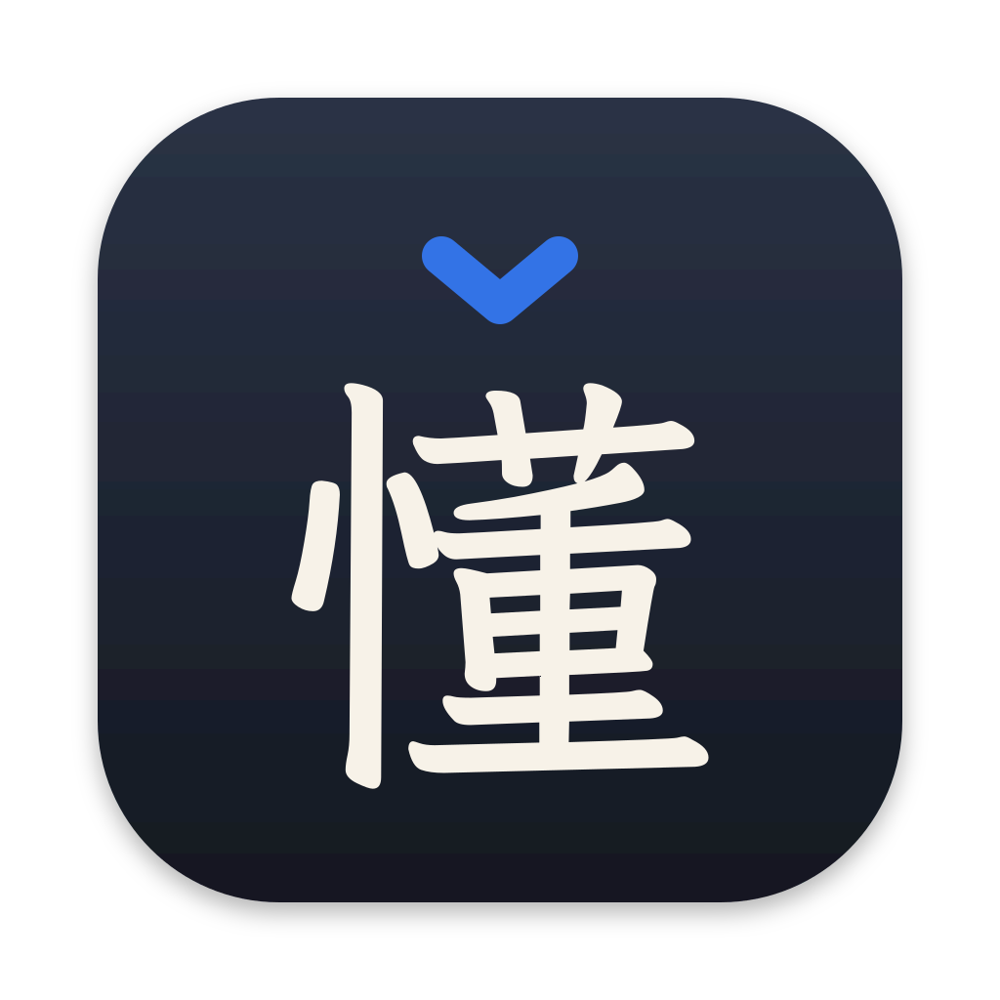

# Kandong 看懂

A macOS menu-bar tool for learning Chinese from the text you meet every day. Highlight Chinese anywhere — or snap a screen region, or copy an image — and get:

- **Reading**: the text with tone-coloured pinyin above each character (instant, offline)
- **Words**: each word with pinyin, gloss and HSK level; ★ to save it to your Vocabulary
- **Translation**: natural English from your AI backend, steered by your Terms and Context
- **Explain**: on-demand grammar and usage notes

Highlight English instead and it shows how to say it in Chinese. See [GLOSSARY.md](GLOSSARY.md) for the vocabulary used in the code and [docs/adr](docs/adr) for the main decisions.

## Install

Needs macOS 27+. Translation works out of the box with Apple Intelligence (turn it on in System Settings → Apple Intelligence & Siri).

```sh
brew install --cask tien-cheng/tap/kandong
```

Or download `Kandong-<version>.zip` from [Releases](https://github.com/Tien-Cheng/kandong/releases) and move **Kandong.app** to Applications.

Kandong isn't notarized by Apple (that needs a paid developer account), so macOS blocks the first launch: open it once, then go to **System Settings → Privacy & Security** and click **Open Anyway**. Then grant **Accessibility** (to read selected text and the tap key). **Screen Recording** is needed for region capture. Releases are all signed with the same certificate, so these permissions carry over when you update.

## Build from source

Needs the Xcode Command Line Tools (full Xcode isn't required).

```sh
scripts/make-signing-identity.sh   # once: stable self-signed identity, so permissions survive rebuilds
scripts/build-app.sh --install     # downloads dictionary data, builds, installs to ~/Applications, launches
```

Tests: `swift test`. Live Codex round-trips: `KANDONG_LIVE=1 swift test --filter LiveCodexTests`. Backend eval (多音字, Translation fidelity, Reverse, Explain, latency): `KANDONG_LIVE=1 KANDONG_EVAL_BACKEND=apple swift test --filter KandongEval`; set `KANDONG_EVAL_BACKEND` to `codex` or to an LM Studio model, e.g. `KANDONG_EVAL_BACKEND='lmstudio:google/gemma-4-e4b'`. Releases are built by GitHub Actions; see [RELEASING.md](RELEASING.md).

## Use

| Shortcut | Action |
|---|---|
| tap right ⌘ | Look up the selection (tap key can be changed in Settings — right ⌥ / ⌃ or off) |
| ⌃⌥L | Look up the selection |
| ⌃⌥S | Capture a screen region |
| ⌃⌥V | Look up the clipboard (image or text) |
| add ⇧ | …using the Local backend instead (e.g. for private messages) |

All shortcuts can be changed in Settings. Esc closes the panel, 📌 keeps it open, and clicking a word reads it aloud. Lookups can also be scripted: `open "kandong://lookup?text=你好"`, `kandong://clipboard`, `kandong://selection`, `kandong://capture`, each optionally with `&local=1`.

## AI backends

Pick and set up Backends in the **AI** section of the main window. Each one shows whether it's ready and, if not, a button to fix it.

- **Apple Intelligence** (default) runs Apple's on-device model: nothing to install or sign in to, and text stays on this Mac. Turn it on in System Settings → Apple Intelligence & Siri. It reads screenshots itself; text too long for it is translated in parts.
- **Codex** uses your ChatGPT subscription through the installed `codex` CLI (`codex app-server`). Sign in once with `codex login`.
- **Add Backend** for LM Studio, Ollama, OpenRouter, OpenAI or any OpenAI-compatible server. Local servers keep text on this Mac; keys for hosted APIs are stored in the Keychain. Vision models are detected for LM Studio, so screenshots go to the model; for text-only models, Kandong reads images with Apple's on-device OCR.
- **LM Studio**: install [LM Studio](https://lmstudio.ai) and start its server, then add an LM Studio Backend and click **Download** next to the model recommended for your Mac's memory: Gemma 4 E4B with 16 GB or more, Gemma 4 12B with 32 GB or more. The list lives in [`models.json`](models.json), so it can change without a new release.
- **Thinking**: each Backend sets how much its model thinks before answering, separately for translating and explaining. Local models translate with thinking off, since it makes small models slow and can stall them. Kandong leaves sampling settings (temperature and so on) to LM Studio and Ollama, which use each model's recommended ones, and stops a reply that runs too long or repeats itself.

If a Backend can't answer, the panel says why and offers the others; click the Backend badge in the panel header to try another one at any time.

## Workspace: Context, Terms, Vocabulary

Plain files in `~/.config/kandong/` (the folder can be changed in Settings). Edits — yours or your agents' — apply to the next lookup:

- `context.md`: who you are and what you read. It is sent with every request.
- `terms.csv` (`chinese,english,note`): fixed translations for names, slang and set phrases.
- `vocabulary.csv`: saved words with the sentence they came from. Anki can import it directly.
- `dictionaries/`: add-on dictionaries in CC-CEDICT format (`简体 简体 [pin1 yin1] /meaning/`), whose words are read as words and passed to the AI as a glossary. **Settings → Dictionaries → Technical terms** downloads the [CSET-ETO Chinese Technical Glossary](https://glossary.eto.tech) (about 15,000 AI, chip and science terms; CC BY-NC 4.0, so non-commercial use only) and converts it here. Add your own files too.

History and repeat-sighting counts are kept in `~/Library/Application Support/Kandong/history.sqlite` (90 days by default).

## Data

Dictionary: [CC-CEDICT](https://www.mdbg.net/chinese/dictionary?page=cc-cedict) (CC BY-SA 4.0). HSK 3.0 levels: [complete-hsk-vocabulary](https://github.com/drkameleon/complete-hsk-vocabulary) (MIT). Both are downloaded by `scripts/fetch-data.sh` and not committed. The icon's 懂 is outlined from [LXGW WenKai](https://github.com/lxgw/LxgwWenKai) (SIL OFL 1.1).

## License

Code: [MIT](LICENSE). The dictionary data keeps its own licenses above; a built `Kandong.app` bundles it, so keep those notices if you redistribute the app.
