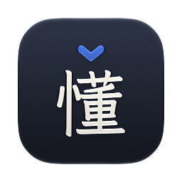

# Kandong 看懂

A macOS menu-bar tool for learning Chinese from the text you meet every day. Highlight Chinese anywhere — or snap a screen region, or copy an image — and get:

- **Reading**: the text with tone-coloured pinyin above each character (instant, offline)
- **Words**: each word with pinyin, gloss and HSK level; ★ to save it to your Vocabulary
- **Translation**: natural English from your AI backend, steered by your Terms and Context
- **Explain**: on-demand grammar and usage notes

Highlight English instead and it shows how to say it in Chinese. See [GLOSSARY.md](GLOSSARY.md) for the vocabulary used in the code and [docs/adr](docs/adr) for the main decisions.

## Install

Needs macOS 26+ (on macOS 26, screenshots are read with on-device OCR rather than by the model). Translation works out of the box with Apple Intelligence (turn it on in System Settings → Apple Intelligence & Siri).

```sh
brew install --cask tien-cheng/tap/kandong
```

Or download `Kandong-<version>.zip` from [Releases](https://github.com/Tien-Cheng/kandong/releases) and move **Kandong.app** to Applications.

Kandong isn't notarized by Apple (that needs a paid developer account), so macOS blocks the first launch: open it once, then go to **System Settings → Privacy & Security** and click **Open Anyway**. Then grant **Accessibility** (to read selected text and the tap key). **Screen Recording** is needed for region capture. Releases are all signed with the same certificate, so these permissions carry over when you update.

### Updates

From 0.4.0, Kandong updates itself. It checks GitHub for a new version once a day, downloads it in the background and installs it when Kandong quits; **Restart to Update** in the menu bar installs it straight away, and **Check for Updates…** checks now. Both can be turned off in **Settings → Updates**. Nothing about your Mac is sent. Updates don't need **Open Anyway** again. Homebrew installs update the same way (the cask is marked `auto_updates`).

## Build from source

Needs the Xcode Command Line Tools (full Xcode isn't required).

```sh
scripts/make-signing-identity.sh   # once: stable self-signed identity, so permissions survive rebuilds
scripts/build-app.sh --install     # downloads dictionary data, builds, installs to ~/Applications, launches
```

Tests: `swift test`. Backend eval (多音字, Translation fidelity, Reverse, Explain, latency): `KANDONG_LIVE=1 KANDONG_EVAL_BACKEND=apple swift test --filter KandongEval`; set `KANDONG_EVAL_BACKEND` to an LM Studio model to evaluate it, e.g. `KANDONG_EVAL_BACKEND='lmstudio:google/gemma-4-e4b'`. Releases are built by GitHub Actions; see [RELEASING.md](RELEASING.md).

## Use

| Shortcut | Action |
|---|---|
| tap right ⌘ | Look up the selection (tap key can be changed in Settings — right ⌥ / ⌃ or off) |
| ⌃⌥L | Look up the selection |
| ⌃⌥S | Capture a screen region |
| ⌃⌥V | Look up the clipboard (image or text) |
| add ⇧ | …using the Local backend instead (e.g. for private messages) |

All shortcuts can be changed in Settings. Tap again while the panel is open to close it, or, for text that mixes Chinese and English, to say it all in Chinese instead (the 中 → EN button in the panel's header does the same).

In the panel, click a word (or use ← →) to see what it means and save it to your Vocabulary:

| Key | In the panel |
|---|---|
| ← → | Previous / next word |
| Space | Say the word (or the whole text) |
| S | Save the word to Vocabulary |
| E | Explain |
| R | Say it the other way (mixed Chinese and English) |
| P | Pin: keep the panel open when clicking elsewhere |
| ⇧⌘C | Copy the Translation (or the Chinese) |
| Esc | Let go of the word, then close |

Lookups can also be scripted: `open "kandong://lookup?text=你好"`, `kandong://clipboard`, `kandong://selection`, `kandong://capture`, each optionally with `&local=1`.

## AI backends

Pick and set up Backends in the **AI** section of the main window. Each one shows whether it's ready and, if not, a button to fix it.

- **Apple Intelligence** (default) runs Apple's on-device model: nothing to install or sign in to, and text stays on this Mac. Turn it on in System Settings → Apple Intelligence & Siri. It reads screenshots itself; text too long for it is translated in parts.
- **ChatGPT** connects directly to an eligible ChatGPT Plus or Pro plan. Open **AI → ChatGPT → Continue with ChatGPT**, finish sign-in and consent in your browser, then choose **Use ChatGPT by default** if you want it to answer normal Lookups. No Codex installation or API key is required. Text and any images you send go to OpenAI; the ⇧ shortcut still uses your Local backend. You can switch saved accounts, reconnect, sign out, or open **Manage usage** in the same settings.
- **Add Backend** for LM Studio, Ollama, OpenRouter, OpenAI or any OpenAI-compatible server. Local servers keep text on this Mac; keys for hosted APIs are stored in the Keychain. Vision models are detected for LM Studio, so screenshots go to the model; for text-only models, Kandong reads images with Apple's on-device OCR.
- **LM Studio**: install [LM Studio](https://lmstudio.ai) and start its server, then add an LM Studio Backend and click **Download** next to the model recommended for your Mac's memory: Gemma 4 E4B with 16 GB or more, Gemma 4 12B with 32 GB or more. The list lives in [`models.json`](models.json), so it can change without a new release.
- **Reading corrections**: the dictionary's pinyin comes first. Each Backend sets how the AI may change it for the context (多音字 like 还 hái/huán):
  - **Choose** (Apple Intelligence and local models): the AI picks one of the dictionary's own readings.
  - **Free** (ChatGPT and hosted models): the AI corrects any reading.
  - **Off**: the dictionary's readings stand.

  Changed readings are marked "context reading". Reverse Lookups get them too: once the Chinese is in, the same Backend is asked how it reads, and the Reading updates.
- **Thinking**: each Backend sets how much its model thinks before answering, separately for translating and explaining. Local models translate with thinking off, since it makes small models slow and can stall them. Kandong leaves sampling settings (temperature and so on) to LM Studio and Ollama, which use each model's recommended ones, and stops a reply that runs too long or repeats itself.

If a Backend can't answer, the panel says why and offers the others; click the Backend badge in the panel header to try another one at any time.

ChatGPT plan usage follows OpenAI's [open-source sign-in flow](https://developers.openai.com/siwc/token-sharing-open-source). Signing in and permission to use the plan are separate: if consent is missing, choose **Enable ChatGPT plan usage**. Usage-limit errors link to [ChatGPT usage settings](https://chatgpt.com/settings/usage). Kandong never switches to another backend or billing method automatically. Tokens stay in your Mac's login Keychain; account labels and preferences stay in Kandong's settings. Image capability detection is conservative when the account's model catalog omits it; choose **Reads images → Yes** for a model that supports images, or use on-device OCR.

The former Codex Backend has been replaced by ChatGPT. Existing Codex default selections move to ChatGPT; connect once through **Continue with ChatGPT** if you haven't already. Other backend selections, saved ChatGPT accounts and preferences are preserved. Kandong does not import or modify Codex CLI credentials, and old Codex model/path settings are discarded because the direct ChatGPT account has its own model catalog.

## Workspace: Context, Terms, Vocabulary

Plain files in `~/.config/kandong/` (the folder can be changed in Settings). Edits — yours or your agents' — apply to the next lookup:

- `context.md`: who you are and what you read. It is sent with every request.
- `terms.csv` (`chinese,english,note`): fixed translations for names, slang and set phrases.
- `vocabulary.csv`: saved words with the sentence they came from. Anki can import it directly.
- `dictionaries/`: add-on dictionaries in CC-CEDICT format (`简体 简体 [pin1 yin1] /meaning/`), whose words are read as words and passed to the AI as a glossary. **Settings → Dictionaries → Technical terms** downloads the [CSET-ETO Chinese Technical Glossary](https://glossary.eto.tech) (about 15,000 AI, chip and science terms; CC BY-NC 4.0, so non-commercial use only) and converts it here. Add your own files too.

History and repeat-sighting counts are kept in `~/Library/Application Support/Kandong/history.sqlite` (90 days by default).

## Data

Dictionary: [CC-CEDICT](https://www.mdbg.net/chinese/dictionary?page=cc-cedict) (CC BY-SA 4.0). HSK 3.0 levels: [complete-hsk-vocabulary](https://github.com/drkameleon/complete-hsk-vocabulary) (MIT). Both are downloaded by `scripts/fetch-data.sh` and not committed. The Reading is set in [LXGW WenKai Lite](https://github.com/lxgw/LxgwWenKai-Lite) (SIL OFL 1.1), downloaded by the same script and bundled in the app; the icon's 懂 is outlined from [LXGW WenKai](https://github.com/lxgw/LxgwWenKai).

## License

Code: [MIT](LICENSE). The dictionary data and the font keep their own licenses above; a built `Kandong.app` bundles them, so keep those notices if you redistribute the app.
